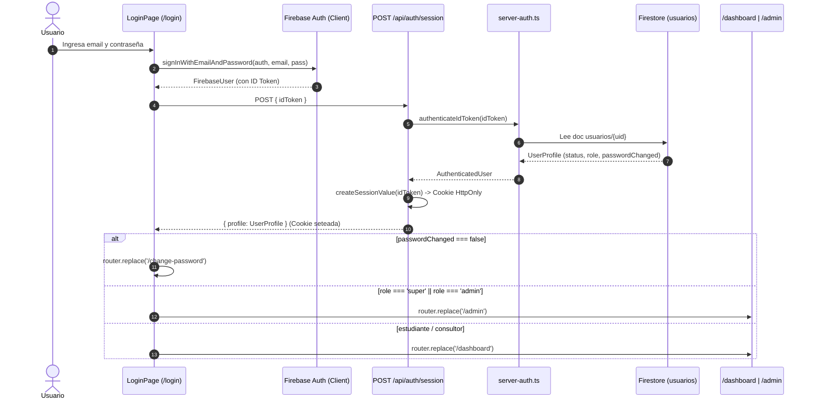

# 🔐 Arquitectura de Autenticación, Sesión y Control de Acceso

Este documento describe la arquitectura técnica de autenticación, control de sesiones en servidor, flujo de registro público y ciclo de vida de credenciales de **B1 Academy** (Ecosistema Finix ERP).

Sincronizado con la bóveda de Obsidian: `[[docs/01_Auth]]` y relacionado con `[[docs/06_LMS_Architecture]]` y `[[docs/24_PasoCero_Empresa_B1Center_ZeroTrust]]`.

---

## 🗺️ Flujo de Autenticación y Redirección (Mermaid)

---

## 🛠️ Componentes Clave del Sistema

### 1. `src/context/AuthContext.tsx`
- **Función:** Maneja el estado reactivo del usuario en el cliente (`currentUser`, `userProfile`, `loading`).
- **Validación de login:** Evalúa `profile.passwordChanged !== false` para determinar si el usuario tiene su contraseña activa.
- **Registro:** Invoca `POST /api/auth/register` enviando `privacyAccepted: true` y la versión de políticas legalmente configurada.

### 2. `src/app/api/auth/session/route.ts`
- **Función:** Establece la cookie de sesión criptográfica en el servidor (`finix_session`).
- **Seguridad:** Cookie `HttpOnly`, `SameSite=lax`, `Secure` en producción, con tiempo de expiración de 5 días (o 1 hora para respaldos de ID Token).
- **Zero-Block:** No realiza consultas bloqueantes externas a servicios de terceros durante la emisión de sesión.

### 3. `src/lib/server-auth.ts`
- **Función:** Validador central en Server Components, Layouts y Endpoints de API.
- **`assertAccountReady`:** Asegura que solo cuentas activas y con contraseña personal definitiva puedan consumir APIs privadas.
- **Aislamiento:** Distingue roles administrativos (`super`, `admin`) de perfiles académicos (`estudiante`, `docente`).

### 4. Layouts Protegidos (`admin`, `dashboard`, `mi-aula`, `simulador`)
- Ejecutan `getSessionState()` en el servidor en el Byte-0 SSR.
- Si no hay sesión: redirigen a `/login?next=[ruta]`.
- Si `passwordChanged === false`: redirigen a `/change-password`.
- Si la sesión está en orden: renderizan la vista sin parpadeos ni rebotes.

### 5. `src/app/change-password/page.tsx`
- **Formulario directo:** Expone los campos de contraseña nueva y confirmación (mínimo 8 caracteres) sin ocultarlos.
- **Acceso:** Si un usuario con contraseña ya creada visita la URL, es redirigido inmediatamente a su destino natural (`/admin` o `/dashboard`).

### 6. `src/app/api/auth/register/route.ts`
- **Registro público:** Da de alta cuentas de estudiantes asignando `role: 'estudiante'`, `status: 'active'`, `passwordChanged: true`.
- **Protección contra ataques:** Rate limiting por IP (máximo 5 altas por hora) y esquema Zod estricto.

---

## 🛡️ Principios Zero-Trust Aplicados
1. **Nunca confiar en el cliente:** Los roles y permisos (`role`, `privateAccountingEnabled`) siempre se definen en el servidor, nunca desde el payload del formulario.
2. **Cookies Seguras:** Tokens de sesión no son accesibles vía JavaScript en el navegador (protección contra XSS).
3. **Idempotencia y Reversión Atómica:** Si la creación del perfil en base de datos falla, el usuario creado en Firebase Auth se revierte inmediatamente.
