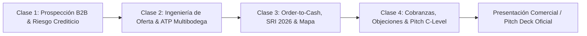

# 💼 Programa Maestro de Operaciones y Demostración Comercial Finix ERP

Documentación técnica y pedagógica del Track Comercial Oficial (`mod-ventas`), estructurado en **4 Clases Magistrales de Alta Complejidad** (2.5 horas de formación ejecutiva y 20 misiones corporativas en simulador) más una **Herramienta Interactiva de Presentación Comercial (Pitch Deck B2B)** para cerrar ventas ante comités de dirección, CEOs y directores financieros.

Sincronizado con la arquitectura general del Campus: [[10_Campus_Escuela_Finix_ERP]] y [[06_LMS_Architecture]].

---

## 🎯 1. Arquitectura de las 4 Clases Magistrales

### 📋 Detalle de Clases y Misiones

| Clase | Código | Duración | Misiones Clave en Simulador | Pantallas Finix |
| :--- | :--- | :--- | :--- | :--- |
| **Clase 1: Prospección B2B, Onboarding Fiscal y Gestión de Riesgo Crediticio** | `mod-ventas-c1` | 35 min | 1. Alta de Socio `C20005` con RUC SRI 2. Asignación de Lista Mayorista y Plazo 30D 3. Fijación de Límite de Crédito USD 10K 4. Simulación de Bloqueo por Exceso de Crédito 5. Procedimiento de Aprobación Gerencial | `SAL006` (Socios), `SAL001` (Cotizaciones), `ADM002` (Aprobaciones) |
| **Clase 2: Ingeniería de la Oferta: Cotizaciones Complejas, ATP Multialmacén y Blindaje de Márgenes** | `mod-ventas-c2` | 35 min | 1. Consulta ATP en Bodega Central y Sucursal 2. Verificación de Costo Ponderado y Margen Bruto 3. Emisión de Cotización Multi-Línea con PDF 4. Descuento Escalonado por Volumen Controlado 5. Alerta de Margen Crítico (< 20%) | `INV001` (Artículos), `SAL001` (Ofertas), `SAL008` (Descuentos) |
| **Clase 3: Ejecución Order-to-Cash, Facturación SRI 2026 y Trazabilidad en Mapa de Relaciones** | `mod-ventas-c3` | 40 min | 1. Conversión de Oferta a Pedido con Reserva 2. Despacho Logístico y Descarga Kardex 3. Factura de Deudores con IVA 15% SRI 2026 4. Retenciones en la Fuente Renta (2%) e IVA (30%) 5. Auditoría Directiva en el Mapa de Relaciones | `SAL002` (Pedidos / Entregas), `SAL004` (Facturas SRI), `SAL009` (Mapa) |
| **Clase 4: Cobranzas, Conciliación Bancaria, Taller Anti-Objeciones y Demostración C-Level de 15 Minutos** | `mod-ventas-c4` | 40 min | 1. Cobranza en Bancos y Asiento Contable 2. Liberación Inmediata del Cupo de Crédito 3. Análisis de Antigüedad de Cartera y DSO 4. Taller Anti-Objeciones I (Precio y Excel) 5. Taller Anti-Objeciones II (Adopción y Plazos) | `BNK001` (Bancos), `SAL006` (Socio / Cartera), `SAL009` (Cockpit / Mapa) |

---

## 🚀 2. Herramienta de Presentación Comercial (Pitch Deck B2B)

Ubicada en `/presentacion-comercial` y enlazada de forma destacada en `/mi-aula`, provee al consultor comercial de:
1. **10 Diapositivas Estratégicas de Alto Rendimiento:**
   - Slide 1: Portada Ejecutiva Finix ERP 10.0.
   - Slide 2: El Costo Oculto del Descontrol (Hojas de cálculo, mermas, cartera vencida).
   - Slide 3: La Propuesta de Valor (Una sola verdad corporativa, cero doble digitación).
   - Slide 4: El Ciclo Order-to-Cash Automatizado en Minutos.
   - Slide 5: Blindaje Financiero: Control de Crédito y Márgenes.
   - Slide 6: Facturación Electrónica SRI 2026 e IVA 15% Nativo.
   - Slide 7: La Joya de la Corona: El Mapa de Relaciones Interactivo.
   - Slide 8: Calculadora de Retorno de Inversión (ROI < 6 meses).
   - Slide 9: Arsenal Anti-Objeciones (Respuestas a las 5 preguntas directivas).
   - Slide 10: Plan de Acción: Taller de Diagnóstico y Empresa en B1 Center.
2. **Modo Notas del Orador (Tecla N):**
   - Guion conversacional paso a paso con las preguntas clave a formular al CEO y CFO.
3. **Integración con Simulador en Vivo:**
   - Botón directo para conmutar entre diapositivas y el simulador de B1 Center.
4. **Modo Impresión / Exportación PDF:**
   - Formato listo para entregar como dossier corporativo impreso o digital.

---

## 🎙️ 3. Voz Oficial de Jorge (`es-MX-JorgeNeural`)

Todas las 48 láminas del programa comercial cuentan con narraciones conversacionales detalladas en `src/content/aula/lecciones.json` que se sintetizan mediante `msedge-tts` en `src/lib/tts.ts`:
- Voz: `es-MX-JorgeNeural` (Jorge).
- Tono: Ejecutivo, dinámico, enfocado en valor de negocio y orientación a resultados.
- Caché inmutable en servidor para reproducción fluida e instantánea.

---

## 🛡️ 4. Verificación de Competencias y Certificado Oficial

Para obtener el **Certificado en Demostración Comercial y Operaciones Finix ERP**:
1. El estudiante debe haber creado su empresa de práctica **B1 Center** en el Paso 0.
2. Debe completar las 4 clases magistrales y las 20 misiones prácticas en el simulador.
3. Debe aprobar el **Examen Oral con el Tutor IA** (`/mi-aula/mod-ventas/oral-exam`) con un puntaje mínimo de 80/100, defendiendo la propuesta de valor del ERP, el flujo Order-to-Cash y la refutación de objeciones.
4. El certificado se emite con hash SHA-256 inmutable, código QR y verificación pública en `/verificar/[codigo]`.
