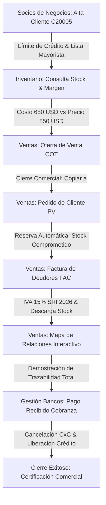

# 💼 Taller Maestro de Operaciones y Demostración Comercial Finix ERP

Documentación técnica y pedagógica de la Ruta Comercial (`mod-ventas`), diseñada como un **módulo único compacto y de punta a punta** para formar personal comercial de alto impacto capaz de dominar las operaciones clave de Finix ERP, ejecutar el flujo Order-to-Cash y comunicar con contundencia los beneficios de negocio a directivos y clientes.

Sincronizado con la arquitectura general del Campus: [[10_Campus_Escuela_Finix_ERP]] y [[06_LMS_Architecture]].

---

## 🎯 1. Objetivos del Módulo Comercial

1. **Dominio Operativo Focalizado:** El personal comercial aprende a usar el sistema ejecutando directamente en la empresa de práctica **B1 Center**:
   - Creación y calificación de clientes en Socios de Negocios (`C20005` / `C20001`).
   - Asignación de límites de crédito, listas de precios preferenciales y condiciones de pago.
   - Consulta multialmacén de stock y protección del margen de venta.
   - Generación en 60 segundos de cotizaciones profesionales (`COT`).
   - Cierre de ventas y reserva automática de stock comprometido (`PV`).
   - Facturación electrónica con **IVA 15% SRI Ecuador 2026** y despacho de mercaderías (`FAC`).
   - Apertura del **Mapa de Relaciones** para demostración directiva de trazabilidad total.
   - Registro de cobranzas bancarias (`Pago Recibido`) y reactivación inmediata de línea de crédito.

2. **Propuesta de Valor & ROI:** Capacitación para erradicar las 3 grandes pérdidas de empresas sin ERP:
   - Caos y vulnerabilidad de hojas de cálculo dispersas.
   - Fugas silenciosas de dinero por mermas y ventas bajo costo.
   - Falta de información en tiempo real para el Gerente General.

3. **Manejo Experto de Objeciones B2B:**
   - *"Es muy caro"* → Demostración de ROI en menos de 8 meses.
   - *"Mi personal no se adaptará"* → Interfaz limpia y perfiles por rol.
   - *"Ya usamos Excel"* → Pistas de auditoría inmutables y control de crédito.
   - *"Tarda mucho en implementarse"* → Metodología ágil y empresa B1 Center preconfigurada.
   - *"Ya tenemos software contable"* → El software contable mira el pasado; el ERP previene en tiempo real.

---

## 🗺️ 2. Flujo Integral Order-to-Cash en Finix ERP

---

## 🏗️ 3. Estructura de Datos y Conexión en el Código

| Componente | Archivo Fuente | Descripción |
| :--- | :--- | :--- |
| **Definición Curricular** | `src/lib/curriculum-data.ts` | Registrado como `mod-ventas` en bloque *Gestión Comercial y CRM*, con `MODULO_VENTAS` exportado. |
| **Clase y Duración** | `src/content/aula/clases.json` | Clase `mod-ventas-c1` ("Taller Integral de Operaciones Comerciales, Beneficios de Negocio y Cierre de Demostración ERP", 45 min). |
| **Contenido y Prácticas** | `src/content/aula/lecciones.json` | 12 láminas ricas con narración de audio completa y 7 misiones evaluadas en el simulador. |
| **Evaluación de Prácticas** | `src/lib/practice-registry.ts` | Mapeo automático de `mod-ventas-c1#2` a `#8` con sus campos esperados. |
| **Normalización y Sinónimos**| `src/lib/practice-check.ts` | Equivalencias para `C20005`, `Banco Pichincha`, `Oferta de Venta`, `Factura de Clientes`, `Pago Recibido` y `Mapa de Relaciones`. |
| **Examen Oral con Tutor IA** | `src/lib/exam-bank.ts` | Banco de 6 preguntas estratégicas sobre valor comercial, ROI, psicología B2B y objeciones. |
| **Acceso Destacado** | `src/app/mi-aula/page.tsx` | Banner Luxury de acceso directo prioritario para el personal comercial. |

---

## 🎙️ 4. Examen Oral de Certificación

El alumno defiende un caso de ventas frente al **Tutor IA** ([[11_Master_B1_Tutor_IA]]) evaluando:
- Claridad conceptual en la propuesta de valor frente a Excel.
- Capacidad para estructurar una demostración de 15 minutos.
- Argumentación contable y fiscal para directores financieros.
- Dominio de la psicología del comprador corporativo.

Superado el examen (mínimo 80/100), el servidor emite el:
`Certificado en Demostración Comercial y Operaciones Finix ERP` con hash SHA-256 inmutable y código QR verificable en `/verificar`.
