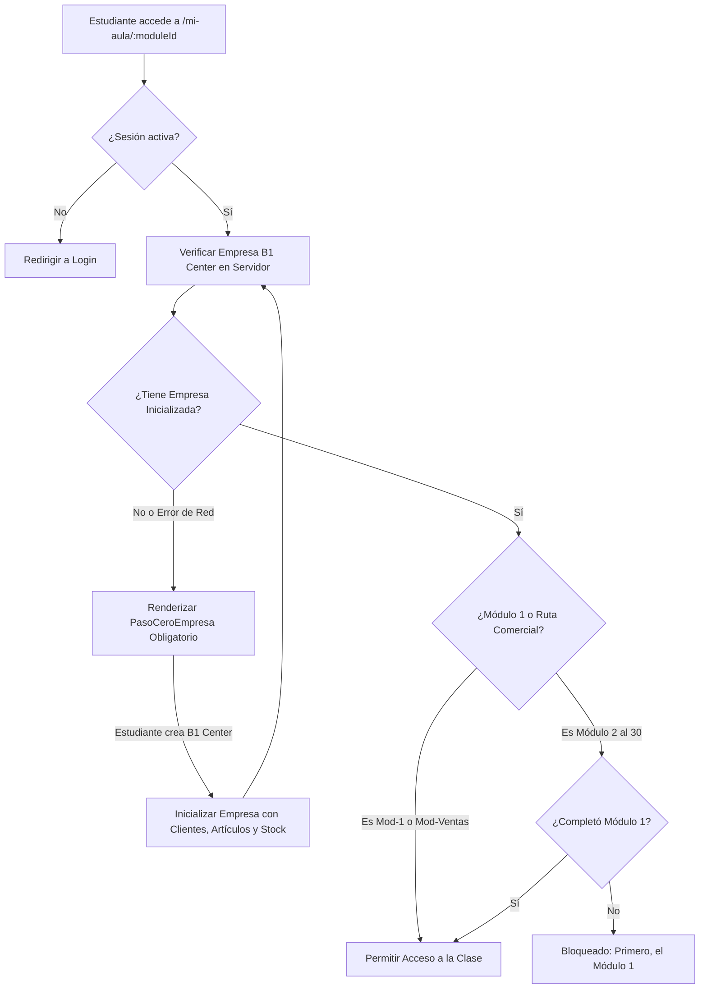

# 🛡️ Paso 0: Empresa B1 Center & Arquitectura Zero Trust de Mi Aula

Documentación de la arquitectura de seguridad y control de acceso estricto de **Mi Aula Virtual**. Garantiza que ningún estudiante o usuario pueda ingresar a ningún módulo, clase, simulador, práctica o examen sin haber inicializado previamente su empresa de prueba **B1 Center**.

Sincronizado con: [[06_LMS_Architecture]], [[10_Campus_Escuela_Finix_ERP]], [[23_Track_Comercial_y_Ventas_ERP]].

---

## 🔒 1. Principio Fundamental: Fallo Cerrado (Fail-Closed)

En versiones anteriores, ante una interrupción de red o fallo de carga, el cliente asumía de forma optimista que la empresa existía (`catch(() => setEmpresaEstado('ok'))`) o que la inducción estaba completa (`catch(() => setInduccionLista(true))`). Además, mientras el estado de la empresa estaba en `'cargando'`, el componente renderizaba el aula completa por defecto.

**Regla de Oro Zero Trust Implementada:**
1. **El sistema falla cerrado:** Ningún error de red, excepción o estado transitorio otorga acceso al aula.
2. **Cero Render Huérfano:** Si `empresaEstado === 'cargando'`, la interfaz muestra un spinner de seguridad y no inicia la descarga de lecciones, ni la reproducción de audio ni el simulador.
3. **Paso 0 Infranqueable:** Si la empresa no existe (`empresaEstado === 'falta'`), se renderiza obligatoriamente `<PasoCeroEmpresa>` en cualquier ruta de módulo (`/mi-aula/[moduleId]`).
4. **Validación Triple en Servidor:** Las APIs del servidor (`/api/lesson-data`, `/api/practice`, `/api/oral-exam`) rechazan con código HTTP `403 Forbidden` cualquier solicitud si `hasInitializedCompany(actor.uid)` retorna `false`.

---

## 🗺️ 2. Diagrama de Flujo de Autenticación y Autorización Zero Trust

---

## 🏗️ 3. Puntos de Control y Archivos Modificados

| Capa | Archivo Fuente | Mecanismo de Control |
| :--- | :--- | :--- |
| **Servidor · Empresa** | `src/lib/company-server.ts` | Función `hasInitializedCompany(uid)` que verifica de forma irrefutable la existencia de `finixCompanies/{uid}/profile/main` con `companyName`. |
| **Servidor · Inducción** | `src/lib/requisitos-aula.ts` | `moduloInduccionCompleto()` exige primero `hasInitializedCompany(uid)` antes de comprobar clases previas. |
| **Servidor · Lecciones** | `src/app/api/lesson-data/route.ts` | Valida `hasInitializedCompany(actor.uid)` antes de despachar diapositivas o audios (403 si falta empresa). |
| **Servidor · Prácticas** | `src/app/api/practice/route.ts` | Valida `hasInitializedCompany(uid)` antes de calificar o guardar intentos de práctica. |
| **Servidor · Examen Oral** | `src/app/api/oral-exam/route.ts` | Exige `hasInitializedCompany(user.uid)` y `moduloInduccionCompleto()` antes de iniciar una sesión de examen con Tutor IA. |
| **Cliente · Aula** | `src/app/mi-aula/[moduleId]/page.tsx` | Estado `empresaEstado`: si es `'cargando'` muestra pantalla segura; si es `'falta'` renderiza `<PasoCeroEmpresa>`; catch falla cerrado a `'falta'`. |
| **Cliente · Catálogo** | `src/app/mi-aula/page.tsx` | Verifica `tieneEmpresa`; desactiva enlaces clickeables en diplomas de especialidad y capstone cuando `!induccionCompleta`. |

---

## 🎯 4. Experiencia de Usuario en el Paso 0

1. El alumno es recibido cordialmente con su nombre de pila en `<PasoCeroEmpresa>`.
2. Se le explica con transparencia que en Finix ERP todo ocurre dentro de una empresa real.
3. Se despliegan los 3 beneficios y el contenido preconfigurado que recibirá:
   - 5 clientes, 4 proveedores y 4 empleados listos.
   - 12 artículos con precio de lista, costo y márgenes calculados.
   - 2 bodegas con existencias físicas iniciales.
4. Al pulsar **"Crear mi B1 Center y empezar"**, el sistema genera los registros con partida doble en lote y desbloquea el aula de forma inmediata sin recargar.
