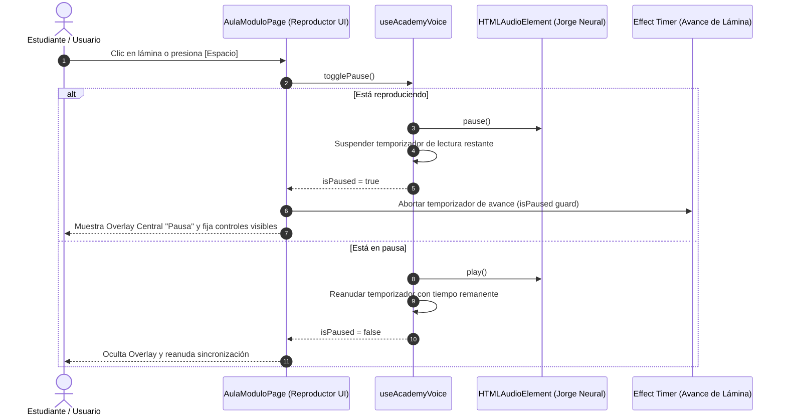

# 🎥 Reproductor de Video Simulado para Láminas Narradas en Mi Aula y Manuales

Documento de arquitectura sincronizado con la bóveda de Obsidian: `[[docs/25_Reproductor_Video_Simulado_MiAula]]`.
Vinculado a: `[[06_LMS_Architecture]]`, `[[06_Manuales]]`, `[[23_Track_Comercial_y_Ventas_ERP]]`, `[[24_PasoCero_Empresa_B1Center_ZeroTrust]]`.

---

## 🎯 1. Propósito y Experiencia de Usuario

Tanto en **Mi Aula** (`src/app/mi-aula/[moduleId]/page.tsx`) como en la biblioteca de **Manuales** (`src/components/site/ManualViewer.tsx`), las diapositivas oficiales de Finix Academy son proyectadas con narración sincronizada de **Jorge Neural (es-MX)** de Edge TTS. Para que el estudiante experimente la sensación de un **reproductor de video profesional de streaming**, se implementó el sistema unificado de simulación de video player con:

1. **Barra de Controles Flotante con Hover:**
   - La barra inferior se oculta automáticamente y reaparece suavemente al pasar el puntero sobre la lámina.
   - Si la lección está pausada, la barra permanece visible de forma persistente.
2. **Pausa y Reanudación Sincronizada (Zero Drifting):**
   - Pausa tanto la pista de audio de Jorge Neural como los temporizadores de avance automático de lámina.
   - La lección jamás avanza por su cuenta si el usuario se retira o pone en pausa la explicación.
3. **Overlay Central de Pausa:**
   - Al pausar, se despliega un telón translúcido (`backdrop-blur`) con botón central de reproducción y la indicación: *"Lección en Pausa · Haz clic o presiona [Espacio] para reanudar"*.
4. **Scrubber / Línea de Tiempo Interactiva:**
   - Control deslizante accesible que permite ver el tiempo transcurrido (`currentTime`) contra la duración total (`duration`) y desplazarse a cualquier punto de la narración.
   - Implementado sin estilos en línea prohibidos (`style={{}}`), utilizando Tailwind CSS atómico y el control nativo con `accent-amber-500`.
5. **Acelerador de Velocidad de Voz:**
   - Multiplicador de velocidad de reproducción cíclico: `1×` → `1.25×` → `1.5×` → `1.75×`.
6. **Saltos Rápidos y Atajos de Teclado:**
   - `[Espacio]`: Pausar / Reanudar.
   - `[←]` / `[→]`: Retroceder / Avanzar 10 segundos.
   - `[Shift + ←]` / `[Shift + →]`: Lámina anterior / siguiente.
   - `[M]`: Silenciar / Activar audio.
   - Detección inteligente de foco para no interferir con campos de entrada (`<input>`, `<textarea>`) del simulador.

---

## 🔄 2. Diagrama de Flujo de Reproducción y Pausa



---

## 🏗️ 3. Componentes y Arquitectura de Código

```mermaid
graph TD
    A[src/app/mi-aula/[moduleId]/page.tsx] -->|Consume Hook| B[src/hooks/useAcademyVoice.ts]
    A -->|Renderiza| C[Contenedor Video Player Hover]
    C --> D[Imagen Lámina WebP]
    C --> E[Overlay Central Pausa]
    C --> F[Barra Flotante Video Controls]
    F --> G[Timeline Scrubber Range Input]
    F --> H[Botones: Play/Pausa, -10s, +10s, Prev/Next]
    F --> I[Velocidad 1x-1.75x & Mute & Fullscreen]
    B -->|Audio Stream| J[API /api/tts?voice=es-MX-JorgeNeural]
```

---

## 🧪 4. Certificación Técnica

- **TypeScript:** Validado con `npx tsc --noEmit` (0 errores).
- **Linter:** Validado con `npm run lint` (0 errores).
- **Compilación de Producción:** Validado con `npm run build` (160 rutas estáticas y dinámicas compiladas con éxito, exit code 0).
- **Aislamiento de Módulos:** No se alteró el backend ni la base de datos de administración.
