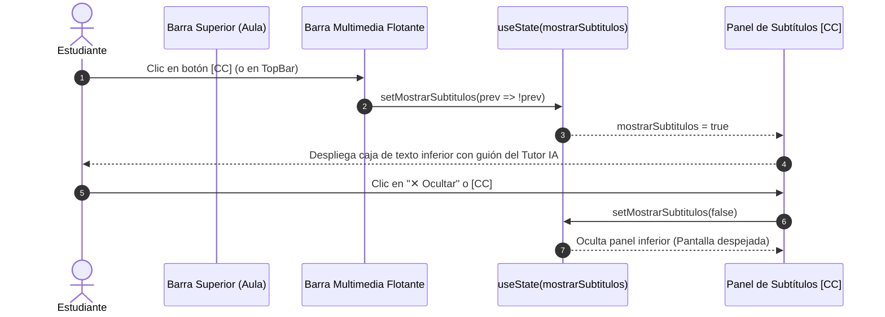

# 🎓 Alineación Pedagógica SAP Business One y Control de Subtítulos [CC]

Documento de arquitectura sincronizado con la bóveda de Obsidian: `[[docs/26_Alineacion_SAP_B1_Subtitulos_CC]]`.
Vinculado a: `[[25_Reproductor_Video_Simulado_MiAula]]`, `[[12_Malla_Curricular]]`, `[[06_LMS_Architecture]]`, `[[24_PasoCero_Empresa_B1Center_ZeroTrust]]`.

---

## 🎯 1. Diagnóstico y Propósito

### A. Resolución de la Disonancia Cognitiva Visual vs. Audio
En lecciones fundacionales como `mod1-c1`, las láminas gráficas oficiales (`public/aula/mod1-c1/Slide_001.webp` a `Slide_012.webp`) muestran explícitamente:
- **Slide 1:** *"¿Qué es SAP Business One? · ERP · PyMEs · Integración"*
- **Slide 2:** *"Entender SAP B1"*
- **Slide 3:** *"ERP para PyMEs"*
- **Slide 5:** *"Antes vs Después de SAP B1 · Sin SAP B1 vs Con SAP B1"*
- **Slide 6:** *"Tu empresa en SAP"*
- **Slide 12:** *"Resumen: SAP B1 en acción"*

Anteriormente, una sustitución global reemplazó "SAP Business One" por "Finix ERP" en los guiones y títulos, generando una contradicción evidente para el estudiante (la imagen decía "SAP B1" y el locutor leía "Finix ERP").

**Solución Implementada:**
1. **Alineación Conceptual:** Se restauró el título oficial en `clases.json` y `malla.json` a:
   `"¿Qué es SAP Business One y el estándar ERP?"`.
2. **Pronunciación Natural en Español:** Se ajustó la explicación de **ERP** para que el narrador neural diga *"sistema de planificación de recursos empresariales"* de forma fluida, eliminando tropiezos fonéticos con siglas en inglés.
3. **Rol de Finix ERP:** Se mantiene la visión estratégica de Pablo donde **SAP Business One** es el estándar de la industria que el alumno aprende a dominar para el mercado laboral, mientras que **Finix ERP** es el entorno de práctica e innovación futura potenciado con Inteligencia Artificial.

---

### B. Control de Subtítulos [CC] y Cero Clutter Visual
En láminas de texto o con viñetas explicativas, el estudiante experimentaba duplicidad de información: el texto aparecía dentro de la diapositiva y simultáneamente en una caja inferior fija (`Tutor IA explicando...`), mientras el audio leía exactamente lo mismo.

**Solución Implementada:**
1. Se incorporó el botón **`[CC]`** tanto en la barra superior como en la barra multimedia flotante junto a la velocidad (`1.75x`).
2. Se configuró `mostrarSubtitulos = false` por defecto para mantener la vista limpia, moderna y cinematográfica.
3. El panel de transcripción solo se abre cuando el estudiante lo solicita pulsando **`[CC]`**, y cuenta con un botón directo de *"✕ Ocultar"*.
4. Se agregó un botón de rescate `needsGesture` ("Activar voz") visible en la barra de controles si el navegador bloquea la reproducción automática de audio por directivas de autoplay.

---

## 🔄 2. Diagrama de Interacción de Subtítulos y Controles [CC]



---

## 🗺️ 3. Mapeo de Archivos Modificados

```mermaid
graph TD
    A[src/app/mi-aula/[moduleId]/page.tsx] -->|Agrega estado mostrarSubtitulos| B[Botones CC en TopBar y PlayerBar]
    A -->|Oculta transcripción por defecto| C[Panel Subtítulos condicional]
    D[src/content/aula/clases.json] -->|mod1-c1 Título| E["¿Qué es SAP Business One y el estándar ERP?"]
    F[src/content/malla/malla.json] -->|M01 c1 Título| E
    G[src/content/aula/lecciones.json] -->|Guiones Slides 1, 3, 5, 6, 12| H[Alineación con láminas SAP B1 y ERP]
```

---

## 🧪 4. Certificación Técnica A+

- **TypeScript:** Validado estrictamente con `npx tsc --noEmit` (0 errores).
- **Linter:** Validado con `npm run lint` (0 errores, 0 warnings bloqueantes).
- **Pruebas Unitarias:** 124 de 124 pruebas superadas (`npm test` con salida 0).
- **Compilación de Producción:** `npm run build` completó con código 0 y 163 rutas estáticas/dinámicas empaquetadas sin errores.
- **Git Push Retenido:** Cumplimiento estricto de la regla de oro: sin push a `origin/main` hasta contar con la autorización explícita de Pablo.
