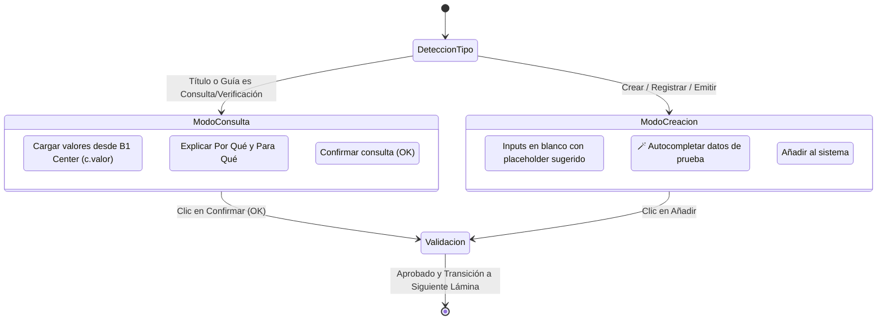

# 🖥️ Simulador de Prácticas: Consultas de Datos Maestros, Margen Comercial y UX Móvil

Este documento describe la arquitectura y la experiencia de usuario (UX) pedagógica implementada en `PracticaValidada.tsx` y el aula virtual de [[15_Plan_Clases_Express_Simulador]] y [[21_Simulador_ERP_MultiEmpresa_FiniAI]].

---

## 🎯 1. El Por Qué y Para Qué: Pedagogía de Datos Maestros

En un sistema ERP como **SAP Business One**, los documentos transaccionales (cotizaciones de venta, órdenes de compra, entregas y facturas) nunca se llenan transcribiendo datos a mano. La arquitectura se basa en **Fichas Maestras**:
- **OITM (Artículos / Items):** Contiene descripción, precio de lista de venta, costo base de inventario, almacén predeterminado y tasa de IVA.
- **OCRD (Socios de Negocios):** Contiene razón social, RUC, dirección fiscal, lista de precios y condiciones de pago.

### Cálculo del Margen Comercial en la Práctica
Al abrir el artículo `A00001` (*Laptop Dell Latitude 3420*):
- **Precio de Venta:** \$850.00 USD
- **Costo de Compra:** \$650.00 USD
- **Margen Bruto Unitario:** \$200.00 USD (30.77% sobre costo / 23.53% margen bruto sobre venta).
- **Bodega Predeterminada:** 01 (Central Quito)
- **Tasa de Impuesto:** IVA 15%

Esta relación enseña al estudiante que el ERP previene el error humano: un vendedor no puede facturar por debajo de costo si el sistema valida el margen contra los datos maestros.

---

## 🔄 2. Arquitectura de Estados en el Simulador

---

## 📱 3. Optimizaciones Críticas de UX Móvil

1. **Auto-Scroll Suave:** Al hacer clic en un submódulo (e.g. *Datos maestros de artículo*), la ventana del formulario se enfoca y hace `scrollIntoView({ behavior: 'smooth', block: 'nearest' })` inmediatamente.
2. **Colapso Inteligente del Menú:** En pantallas pequeñas (`< md`), el árbol de navegación se colapsa automáticamente al abrir la ventana para no forzar al estudiante a scrollear 400px de carpetas.
3. **Selector Rápido de Vista Móvil:** Un botón superior permite alternar instantáneamente entre `[ 📁 Ver menú ]` y `[ 📄 Ver ventana ]`.
4. **Cero Adivinanzas:** El banner pedagógico azul muestra siempre los valores requeridos y su significado en la empresa.

---

## 🔗 Enlaces Relacionados
- [[09_Simulador_Integral_Desktop]]
- [[15_Plan_Clases_Express_Simulador]]
- [[21_Simulador_ERP_MultiEmpresa_FiniAI]]
- [[26_Alineacion_SAP_B1_Subtitulos_CC]]
