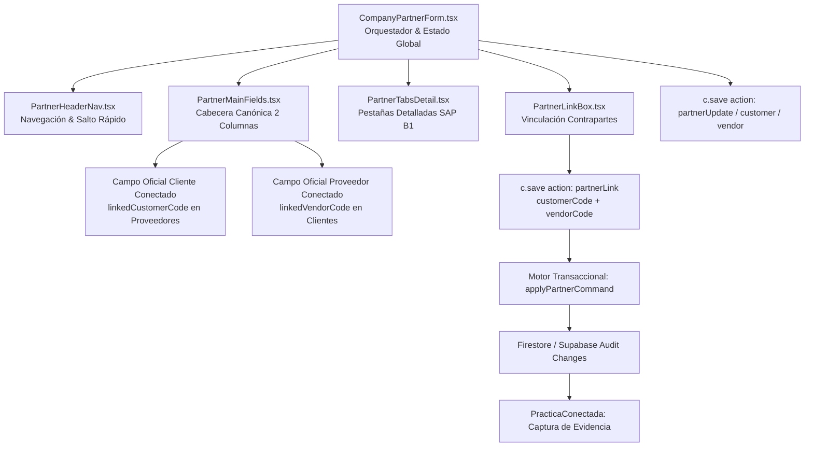
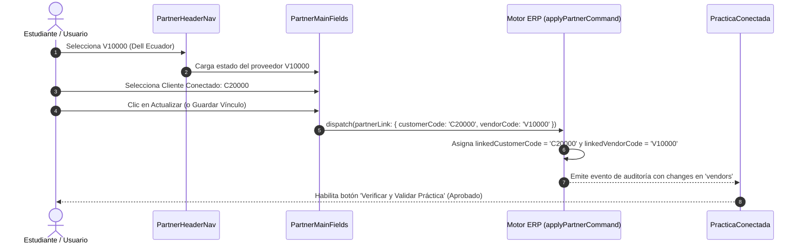

# 🏢 28. Arquitectura Modular de Datos Maestros de Interlocutores Comerciales (OCRD)

Enlazado con: [[09_Simulador_Integral_Desktop]], [[21_Simulador_ERP_MultiEmpresa_FiniAI]], [[24_PasoCero_Empresa_B1Center_ZeroTrust]], [[27_Simulador_Practicas_Consultas_UX_Movil]].

---

## 🎯 1. Objetivo y Alcance

Este documento describe la arquitectura modular del subsistema de **Datos Maestros de Interlocutores Comerciales (OCRD)** en Finix ERP / SAP Business One, garantizando el cumplimiento estricto del límite de líneas por archivo (< 500 líneas), la segregación de responsabilidades y la correcta vinculación de contrapartes comerciales (**Cliente Conectado** y **Proveedor Conectado**).

---

## 🗺️ 2. Diagrama de Arquitectura Modular OCRD

---

## 🧩 3. Desglose de Componentes Modulares (< 500 líneas)

| Componente | Archivo | Líneas | Responsabilidad |
| :--- | :--- | :--- | :--- |
| **Orquestador Principal** | `src/components/finix-screens/CompanyPartnerForm.tsx` | < 480 | Gestión del ciclo de vida, atajos de teclado SAP B1 (`Ctrl+A`, `Ctrl+F`, `Ctrl+S`, `Esc`), dispatch de comandos a `useCompany`. |
| **Navegación y Búsqueda** | `src/components/finix-screens/partner/PartnerHeaderNav.tsx` | ~130 | Indicadores de modo (`Crear`, `Buscar`, `Visualizar/Actualizar`), paginador oficial (`\|<`, `<`, `X/Y`, `>`, `>\|`) y selector rápido dropdown. |
| **Campos Maestros OCRD** | `src/components/finix-screens/partner/PartnerMainFields.tsx` | ~300 | Estructura canónica a dos columnas: Código, Razón Social, Grupo, Ciudad, RUC, Tipo de Socio, Estado, y campos de contraparte (`Cliente conectado` / `Proveedor conectado`). |
| **Detalle de Pestañas** | `src/components/finix-screens/PartnerTabsDetail.tsx` | ~480 | Pestañas oficiales SAP B1: General, Personas de contacto, Direcciones, Condiciones de pago, Finanzas (SRI), Anexos. |
| **Caja de Vinculación** | `src/components/finix-screens/partner/PartnerLinkBox.tsx` | ~110 | Interfaz dedicada para relacionar mutuamente un Cliente y un Proveedor activos sin disparar validaciones HTML5 huérfanas. |

---

## 🔗 4. Flujo de Vinculación de Contrapartes (`mod2-c1#8`)

En el currículo oficial de SAP Business One, cuando una misma entidad jurídica actúa como cliente y proveedor (ejemplo: `V10000 · Dell Ecuador` y `C20000 · Maxi-Teq`):

---

## 🛡️ 5. Blindaje de Calidad y Cero Regresiones

- **TypeScript estricto:** 0 errores en `tsc --noEmit`.
- **Suite de pruebas:** 201/201 tests unitarios superados en `tests/*.test.cjs`.
- **Regla de líneas:** Ningún subcomponente supera las 500 líneas, garantizando mantenibilidad inmediata y legibilidad de código.
