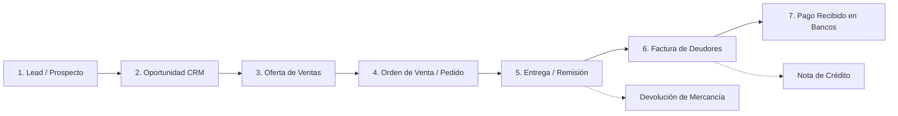
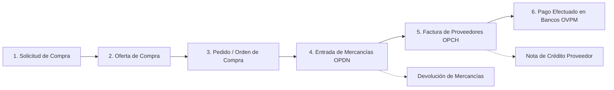

# 📘 Catálogo Maestro de Procesos, Pantallas y Reglas de Negocio de SAP Business One
> **Fuente de Verdad Técnica:** Videos Oficiales de Capacitación y Operación Real de SAP Business One (GenPyme).  
> **Propósito:** Documento canónico para la calibración y perfeccionamiento 1:1 del Simulador SAP B1 de Finix Academy.

---

## 🧭 1. Anatomía Visual y Navegación del Sistema Clásico SAP Business One

De acuerdo con el análisis de los videos `HWdo2XCHZPg` y `xFB8DpnhaWE`, la interfaz auténtica de SAP Business One opera como un entorno de escritorio MDI (*Multiple Document Interface*) compuesto por 5 capas estructurales:

```
┌────────────────────────────────────────────────────────────────────────────────────────┐
│ 1. Barra de Menús: Archivo | Editar | Visualizar | Datos | Pasar a | Módulos | ...     │
├────────────────────────────────────────────────────────────────────────────────────────┤
│ 2. Barra de Herramientas: [Imprimir][Email][Excel][Word][PDF] | [🔍][📄] | [◀][▶] | [⚙️]│
├───────────────┬────────────────────────────────────────────────────────────────────────┤
│ 3. Cajón de   │ 4. Lienzo de Trabajo MDI (Fondo Azul Turquesa / Cyan Gradiente)         │
│    Módulos    │                                                                        │
│ - Gestión     │   ┌──────────────────────────────────────────────────────────────┐     │
│ - Finanzas    │   │ Ventana de Transacción (ej. Orden de Venta / Factura)        │     │
│ - CRM         │   │ ──────────────────────────────────────────────────────────── │     │
│ - Ventas      │   │ Cabecera Izq: Socio / Nombre │ Cabecera Der: Nº / Fechas     │     │
│ - Compras     │   │ Pestañas: [Contenido] [Logística] [Finanzas] [Anexos]        │     │
│ - Bancos      │   │ Matriz de Artículos: # | Código | Descripción | Cant | Total │     │
│ - Inventario  │   │ Pie: Empleado | Comentarios  │ Totales: Subtotal, IVA, Total │     │
│ - Producción  │   │ Botones: [Crear (Azul)] [Cancelar (Gris)]    [Copiar de ▾]   │     │
│ - Informes    │   └──────────────────────────────────────────────────────────────┘     │
├───────────────┴────────────────────────────────────────────────────────────────────────┤
│ 5. Barra de Estado: [Mensaje del sistema en verde] | [Fecha / Hora] | [SAP Business One]│
└────────────────────────────────────────────────────────────────────────────────────────┘
```

### 1.1. Los Botones Críticos de la Barra de Herramientas (Explicación del Experto)
* **Prismáticos (`🔍`):** Cambia el documento a **Modo Buscar** (`Ctrl+F`). Los campos clave se vuelven amarillos para filtrar por cliente o número.
* **Hoja en blanco con estrella/más (`📄`):** Pasa a **Modo Creación** (`Ctrl+A`). Limpia el formulario para registrar una nueva transacción.
* **Flechas de navegación (`|◀`, `◀`, `▶`, `▶|`):** Primer registro, Anterior, Siguiente y Último registro creado en el sistema.
* **Previsualización de Asiento Contable (`💲/⚖️`):** Muestra el asiento preliminar que generará el documento antes de crearlo.
* **Parametrizaciones de Formulario (`⚙️` Engranaje):** Permite activar o desactivar columnas de la matriz (ej. Número de serie, Almacén, Centro de costo).
* **Bloqueo de Pantalla (`🔒` Candado):** Bloquea la sesión al ausentarse del puesto de trabajo.

---

## 🔄 2. Circuito Completo de Ventas (Order-to-Cash)
> **Video Maestro:** `b6dbA9Ooqdg` (Circuito Completo de Ventas, 9.5 mins)  
> **Videos Específicos:** `HmxSF6elWq0` (Oferta), `9p_F9qBeS5Y` (Orden de Venta), `wRHXHkK59WA` (Factura)



### 2.1. Estructura Estándar de Todo Documento de Ventas
Todos los documentos de venta (`Oferta`, `Orden`, `Entrega`, `Factura`) comparten exactamente 3 bloques:
1. **Encabezado (Cabecera):**
   * *Lado Izquierdo:* Código de Cliente (`CardCode`), Razón Social (`CardName`), Persona de contacto, Número de referencia del cliente, Moneda (`MN` / `USD`).
   * *Lado Derecho:* Serie y Número de documento, Estado (`Abierto` / `Cerrado`), **3 Fechas Obligatorias**:
     * `Fecha de contabilización`: Cuándo impacta la contabilidad.
     * `Fecha de entrega / vencimiento`: Cuándo se despacha o cuándo vence el pago.
     * `Fecha de documento`: Fecha fiscal y legal del comprobante.
2. **Cuerpo Central (4 Pestañas Obligatorias):**
   * **Contenido:** Matriz de artículos: `#`, `Número de artículo` (con flecha amarilla), `Descripción`, `Cantidad`, `Precio por unidad`, `% Descuento`, `Indicador de impuestos` (ej. IVA 15%), `Total (ML)`.
   * **Logística:** Dirección de destino de mercancía (`Destino: ENTREGA`), dirección fiscal de factura, clase de expedición/transporte.
   * **Finanzas:** Condiciones de pago (ej. Contado, 30 días), lista de precios, vía de pago, cuenta asociada.
   * **Anexos:** Archivos adjuntos (PDFs de órdenes de compra del cliente, correos, especificaciones técnicas).
3. **Pie de Documento:**
   * *Izquierda:* Empleado del dpto. de ventas, Propietario del documento, Cuadro de Comentarios.
   * *Derecha:* Total antes de descuento, Descuento %, Gastos adicionales (flete/seguro), Redondeo, Impuesto (IVA), **Total del Documento**.
   * *Acciones:* Botón primario azul `[Crear]`, botón gris `[Cancelar]`, y a la derecha los botones de arrastre `[Copiar de ▾]` y `[Copiar a ▾]`.

### 2.2. Reglas Contables y Logísticas del Circuito de Ventas
* **Oferta de Ventas (`HmxSF6elWq0`):**
  * *Efecto Contable:* **CERO** impacto contable (no genera póliza en el libro mayor).
  * *Efecto Stock:* **CERO** afectación de inventario físico ni comprometido.
* **Orden de Venta / Pedido (`9p_F9qBeS5Y`):**
  * *Efecto Contable:* No genera asiento contable.
  * *Efecto Stock:* Aumenta la cantidad **Comprometida** en el almacén (`OITW.IsCommited`), protegiendo el stock de otras ventas pero sin reducir el stock físico.
* **Entrega de Mercancías (`b6dbA9Ooqdg`):**
  * *Efecto Contable:* Genera asiento de costo de ventas:
    * **Debe:** Costo de Ventas (`5.x.x`).
    * **Haber:** Existencias / Inventario (`1.x.x`).
  * *Efecto Stock:* Disminuye el **Stock Físico** en bodega (`OITW.OnHand`) y libera la cantidad comprometida.
* **Factura de Deudores (`wRHXHkK59WA`):**
  * *Efecto Contable:* Reconocimiento de ingreso y derecho de cobro:
    * **Debe:** Clientes / Deudores comerciales (`1.x.x` por el Total).
    * **Haber:** Ventas / Ingresos Operacionales (`4.x.x` por el Subtotal).
    * **Haber:** IVA por Pagar / Débito Fiscal (`2.x.x` por el Impuesto).
  * *Inmutabilidad:* **Una vez creada la factura, los campos quedan bloqueados en gris oscuro y no se puede modificar.** Solo admite Nota de Crédito o Anulación.

---

## 🛒 3. Circuito Completo de Compras (Procure-to-Pay)
> **Video Maestro:** `crsG9H0Fwi8` (Purchasing Process in SAP Business One, 13 mins)  
> **Videos Específicos:** `H6jclCeYU9o` (Solicitud de Compra), `tSSLYU4-z-k` (Orden de Compra), `JOY2LLwbLy8` (Entrada), `hvUPGZFVGbI` (Factura Proveedor)



### 3.1. Reglas y Procedimientos del Circuito de Compras
1. **Solicitud de Compra (`H6jclCeYU9o`):**
   * Generada por cualquier empleado o departamento que requiere insumos.
   * Campos clave: `Usuario solicitante`, `Departamento`, `Fecha necesaria` (cuándo se requiere el material). No compromete a la empresa.
2. **Pedido de Compra (`tSSLYU4-z-k`):**
   * Formaliza el acuerdo comercial con el proveedor.
   * *Efecto Stock:* Aumenta la columna de **Stock Solicitado / Pedido** (`OITW.OnOrder`).
   * *Efecto Contable:* Ninguno.
3. **Entrada de Mercancías / Recepción (`JOY2LLwbLy8`):**
   * Registra el ingreso físico de los camiones o bultos en la bodega.
   * *Efecto Stock:* Aumenta el **Stock Físico** en bodega (`OnHand`).
   * *Efecto Contable:* Genera asiento provisional de compras:
     * **Debe:** Inventario / Existencias (`1.x.x`).
     * **Haber:** Provisión de Compras / Facturas Pendientes de Recibir (`2.x.x`).
4. **Factura de Proveedores (`hvUPGZFVGbI`):**
   * Cancela la provisión y registra la cuenta por pagar legal:
     * **Debe:** Provisión de Compras (`2.x.x` cancelando la provisión de la entrada).
     * **Debe:** IVA Compras / Crédito Tributario (`1.x.x`).
     * **Haber:** Proveedores por Pagar (`2.x.x` por el Total de la factura).

---

## 🏦 4. Gestión de Bancos y Tesorería
> **Videos Clave:** `C8m5D2k-Bug` (Pagos Recibidos), `Tdi602NnBgM` (Pagos Efectuados)

### 4.1. Pagos Recibidos (Cobros a Clientes - `C8m5D2k-Bug`)
* **Ruta Oficial:** `Gestión de Bancos > Pagos recibidos > Pagos recibidos`.
* **Anatomía de la Pantalla:**
  * Cabecera con selector radial: `🔘 Cliente`, `⚪ Proveedor`, `⚪ Cuenta`.
  * Al elegir el cliente (`C00004 - AE CAPITAL`), el sistema lista automáticamente en una matriz todas las facturas abiertas del cliente.
  * Columnas de la matriz: `Seleccionado [☑]`, `Nº Documento`, `Clase de Documento` (`RF` = Factura), `Fecha`, `Días de atraso` (en rojo si venció), `Total`, `Saldo vencido`, `Pago total`.
  * **Soporte de Pago Parcial:** Si el cliente solo abona una parte, se edita la celda `Pago total` (ej. abona \$1,000 de \$2,320). La factura permanece abierta con saldo restante.
* **Ventana de Medios de Pago (El "Saquito de Dinero" `💰`):**
  * Al pulsar el icono de Medios de Pago en la barra de herramientas, se abre una ventana modal con 4 pestañas:
    1. **Transferencia:** Cuenta de mayor bancaria, Fecha de transferencia, Importe, Referencia bancaria.
    2. **Cheque:** Banco emisor, Sucursal, Nº de cheque, Fecha de cobro, Importe.
    3. **Tarjeta de crédito:** Nombre de tarjeta, Nº de tarjeta, Vencimiento, Nº de voucher, Importe.
    4. **Efectivo:** Cuenta de caja general, Importe.
* **Asiento Contable Generado:**
  * **Debe:** Banco / Caja (`1.x.x`).
  * **Haber:** Clientes / Deudores (`1.x.x`).

---

## 📊 5. Finanzas, Contabilidad y Plan de Cuentas
> **Videos Clave:** `eXHE-IRKAaE` (Asiento Contable), `GaRJP3LQvAY` (Plan de Cuentas), `g2PAnQtCOTk` (Libro Mayor), `oohEbGUuS-U` (Balance)

### 5.1. Registro en el Diario / Asiento Contable (`eXHE-IRKAaE`)
* **Ruta Oficial:** `Finanzas > Asiento`.
* **Cabecera:** Serie, Nº de transacción, Fecha de contabilización, Fecha de vencimiento, Fecha de documento, Comentarios, Origen (`RF` = Factura ventas, `PU` = Factura compras, etc.).
* **Matriz de Cuentas:**
  * Cada fila especifica: `Código de Cuenta o Socio`, `Nombre de Cuenta`, `Débito (Debe)`, `Crédito (Haber)`, `Débito ME / USD`, `Crédito ME / USD`, `Proyecto`, `Norma de reparto`.
  * **Regla de Cuadre Obligatorio:** El sistema valida `Suma Débito == Suma Crédito`. Si hay diferencia de 0.01 centavo, el botón `[Crear]` se deshabilita o emite alerta roja en la barra de estado.

### 5.2. Plan de Cuentas (`GaRJP3LQvAY`)
* Organizado en **Cajones Contables** oficiales de SAP B1:
  1. Activo
  2. Pasivo
  3. Patrimonio Neto
  4. Ingresos
  5. Costo de Ventas
  6. Gastos de Operación
  7. Otros Ingresos y Gastos
  8. Impuestos
* Diferencia estricta entre **Cuentas de Título** (carpetas no imputables, en negrita) y **Cuentas de Mayor Activas** (postables, con casilla de moneda y saldo).

---

## 📦 6. Inventario, Artículos y Producción
> **Videos Clave:** `t5lc88ibZHU` (Datos Maestros Artículos), `vI_nkpanEJI` (BOM), `QVvVLjClGhM` (Fabricación)

### 6.1. Ficha de Datos Maestros de Artículo (`t5lc88ibZHU`)
* **Tres Casillas de Control Mandatorias:**
  1. `☑ Artículo de inventario`: Lleva control de existencias en almacén físico.
  2. `☑ Artículo de venta`: Disponible para ofertar y facturar en el módulo de ventas.
  3. `☑ Artículo de compra`: Disponible para cotizar y comprar en el módulo de compras.
* **Pestañas:** `General`, `Datos de compras`, `Datos de ventas`, `Datos de inventario` (stock por almacén: En stock, Comprometido, Solicitado, Disponible), `Planificación` (MRP), `Producción`, `Propiedades`.
* **Fórmula de Stock Disponible:**
  $$\text{Disponible} = \text{En Stock} - \text{Comprometido} + \text{Solicitado}$$

---

## 💎 7. Plan de Acción Inmediato para el Simulador

Para erradicar definitivamente la pantalla en blanco y lograr la perfección idéntica a los videos de GenPyme:

1. **Reemplazo de Fondos y Eliminación de Espacios en Blanco:**
   * Sustituir el fondo blanco vacío por el **Lienzo Oficial SAP B1**: gradiente cyan/teal suave (`#cde7f0` a `#e2f2f7`).
   * La ventana del documento (`Orden de venta`, `Factura`, `Bancos`) debe centrarse como una ventana MDI real con sus botones de control (`_`, `□`, `×`).
2. **Rediseño del Módulo de Bancos:**
   * Eliminar el bloque plano "Banca en linea Banco Pichincha".
   * Reemplazarlo por la pantalla oficial **`Pagos Recibidos`** y **`Pagos Efectuados`** de SAP B1: selector de socio, matriz con checkboxes para marcar facturas pendientes y modal de "Medios de Pago" (`Transferencia`, `Cheque`, `Efectivo`).
3. **Barra de Herramientas y Menús Fieles:**
   * Actualizar [`FinixToolBar.tsx`](file:///c:/Users/pablo/OneDrive/Desktop/proyectos%20web/sap%20academy/src/components/desktop/FinixToolBar.tsx) con la iconografía real de SAP (Prismáticos, Hoja nueva, Navegadores, Engranaje).
   * Añadir la Barra de Estado inferior con mensaje verde de éxito y logo oficial de SAP Business One.
4. **Flechas Amarillas de Navegación (`Link Arrows`):**
   * En todas las matrices (código de cliente, código de artículo, número de origen), incluir el botón dorado `▶` que al hacer clic abra la ficha del maestro correspondiente.
