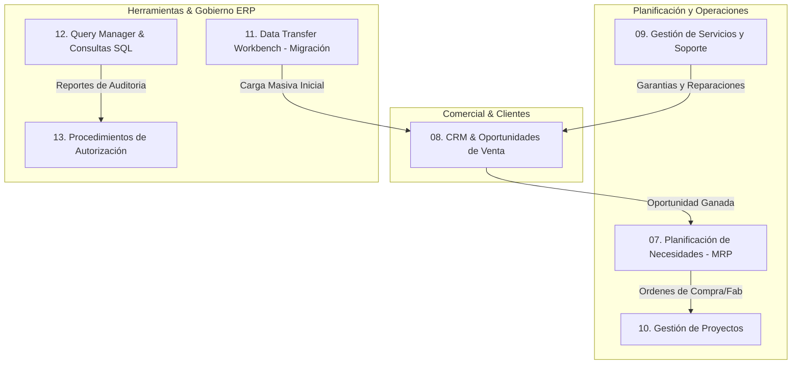

# 📘 Catálogo Maestro de Procesos, Pantallas y Reglas de Negocio: Módulos 07 a 13 de SAP Business One
> **Fuente de Verdad Técnica:** Videos Oficiales de Capacitación y Operación Real de SAP Business One (Partners Certificados: Academia Exxis, Corponet, ProjectLine, CVM Group, B1Pro, Battleship Cobra).  
> **Propósito:** Documento canónico para la calibración y perfeccionamiento 1:1 del Simulador, Manuales y Clases de Finix Academy.  
> **Sincronización:** Vinculado con [[PROCESOS_SAP_B1_GENPYME]] y [[09_Simulador_Integral_Desktop]].

---

---

## 📋 07. Planificación de Necesidades (MRP)
> **Capturas de Referencia:** `public/sap-authentic-screens/07_MRP/` (54 fotogramas)

El motor MRP en SAP Business One calcula la demanda futura neta a partir de los pedidos de clientes existentes, los acuerdos globales, el stock de seguridad y las previsiones de venta (Forecast).

### 7.1. Previsiones de Ventas (Forecast)
* **Ventana:** *Gestión de Previsiones de Ventas*
* **Estructura:** Código de previsión, fecha inicio y fin, periodicidad (Semanal / Mensual).
* **Matriz:** Código de artículo, Almacén, Cantidad pronosticada por cada columna de período.

### 7.2. Asistente de Planificación MRP (6 Pasos Críticos)
1. **Paso 1: Selección de Escenario:** Creación de un escenario nuevo o selección de uno guardado (ej. `PLAN_PRODUCCION_2026`).
2. **Paso 2: Horizonte de Planificación:** Fechas de inicio y fin, tamaño del bucket de tiempo (Días, Semanas o Meses) y días de vacaciones / festivos.
3. **Paso 3: Selección de Artículos:** Artículos fabricados y comprados, filtros por proveedor preferente, grupo de artículos o propiedades.
4. **Paso 4: Fuentes de Datos de Inventario:** Selección de almacenes consolidados vs almacenes excluidos. Reglas de cálculo: Stock existente + Ofertas + Pedidos de clientes + Órdenes de fabricación + Órdenes de compra.
5. **Paso 5: Restricciones de Documentos:** Inclusión de solicitudes de pedido, pedidos abiertos y acuerdos marco.
6. **Paso 6: Resultados y Recomendaciones:** Cuadrícula de cálculo que desglosa por cada artículo:
   * Stock inicial.
   * Demanda bruta (pedidos + previsión).
   * Oferta programada (órdenes abiertas).
   * Stock final proyectado.
   * **Recomendación:** Generación con un clic de *Solicitudes de Compra*, *Órdenes de Fabricación* o *Traslados entre Almacenes*.

---

## 🤝 08. CRM y Oportunidades de Venta
> **Capturas de Referencia:** `public/sap-authentic-screens/08_CRM_Oportunidades/` (26 fotogramas)

Gestión estructurada del ciclo de prospección comercial antes de la emisión de una oferta o pedido formal.

### 8.1. Ventana de Oportunidades de Venta
* **Cabecera Izquierda:**
  * Código del socio de negocios (`CardCode`).
  * Nombre del socio de negocios.
  * Persona de contacto.
  * Importe de factura total acumulado.
  * Territorio del cliente.
  * Empleado de ventas asignado.
  * Titular del registro.
* **Cabecera Derecha:**
  * Nombre de la oportunidad.
  * Número correlativo (# oportunidad).
  * Estado del documento: `Abierto` | `Ganado` | `Perdido`.
  * Fecha de inicio y fecha estimada de cierre.
  * Actividades abiertas pendientes.
  * Barra gráfica de **% de Cierre**.

### 8.2. Pestañas Oficiales de la Oportunidad
* **[Potencial]:** Monto bruto potencial, monto ponderado (Monto × Probabilidad), ganancia bruta estimada.
* **[General]:** Canal de distribución, nivel de interés (Bajo, Medio, Alto).
* **[Etapas]:** Matriz histórica de seguimiento comercial:
  * `#` Fila correlativa.
  * `Fecha de inicio` y `Fecha de cierre`.
  * `Etapa`: Lead (10%), Calificación (25%), Propuesta (50%), Negociación (75%), Cierre.
  * `% Probabilidad` y `Monto Ponderado`.
  * `Socio de negocios / Documento Vinculado` (Oferta de venta o Pedido).
* **[Socios de negocios] y [Competidores]:** Registro de competidores en la puja y nivel de amenaza.
* **[Resumen]:** Conclusión, fecha real de cierre y motivo en caso de pérdida.
* **[Anexos]:** Documentación técnica y propuestas adjuntas.

---

## 🔧 09. Gestión de Servicios y Soporte Técnico
> **Capturas de Referencia:** `public/sap-authentic-screens/09_Servicios/` (24 fotogramas)

Soporte post-venta, garantías y control de equipos instalados.

### 9.1. Tarjeta de Equipo del Cliente
* Identificador único por **Número de Serie de Fabricante** o número de serie interno de SAP B1.
* Vínculo directo al cliente (`CardCode`), dirección de instalación, técnico responsable y fecha de entrega.
* Historial completo de llamadas de servicio y piezas reemplazadas.

### 9.2. Llamada de Servicio (Service Call)
* **Cabecera:** Cliente, número de serie del equipo, artículo, asunto, tipo de llamada, origen (Teléfono, Web, Email), prioridad (Baja, Media, Alta) y estado (Abierto, Pendiente, Cerrado).
* **Pestañas:**
  * **[Comentarios]:** Descripción detallada de la avería o síntoma reportado.
  * **[Operaciones]:** Técnico asignado, fecha de visita programada, horas trabajadas y resolución técnica.
  * **[Gastos y Repuestos]:** Consumo de inventario para la reparación (artículos y repuestos facturables o por garantía).
  * **[Historial]:** Consultas a la base de conocimiento de soluciones técnicas (`Solutions Knowledgebase`).

### 9.3. Contratos de Servicio (SLA)
* Tipo de contrato: Por número de serie o por cliente general.
* Niveles de servicio: Tiempos de respuesta (ej. 4 horas o 24 horas), días de cobertura (Lunes a Viernes / 24x7).
* Inclusión de mano de obra, repuestos y traslados.

---

## 📁 10. Gestión de Proyectos
> **Capturas de Referencia:** `public/sap-authentic-screens/10_Proyectos/` (28 fotogramas)

Control operativo y contable de proyectos a largo plazo (obras, consultorías, despliegues tecnológicos).

### 10.1. Cabecera del Proyecto
* Código de proyecto, Nombre descriptivo, Cliente asociado, Proyecto financiero contable (para imputación analítica), Fechas proyectadas y reales.
* Estado: `Iniciado`, `Pausado`, `Detenido`, `Finalizado`.

### 10.2. Estructura de Etapas y Tareas
* Matriz jerárquica con fases (`Fase 1: Levantamiento`, `Fase 2: Configuración`, `Fase 3: Pruebas`).
* Responsable por etapa, porcentaje de avance acumulado e hitos (`Milestones`).
* **Documentos Vinculados:** Asignación de Órdenes de Compra, Facturas de Proveedores y Entregas directamente a la etapa correspondiente del proyecto.

### 10.3. Resumen Financiero y Diagrama de Gantt
* Conciliación automática:
  * Presupuesto aprobado.
  * Costos reales acumulados (materiales + mano de obra + gastos externos).
  * Monto facturado al cliente.
  * Margen de rentabilidad en tiempo real.
* Visualización en Diagrama de Gantt de la línea de tiempo del proyecto.

---

## 🔄 11. Data Transfer Workbench (DTW) - Migración de Datos
> **Capturas de Referencia:** `public/sap-authentic-screens/11_DTW_Migracion/` (48 fotogramas)

Herramienta oficial de SAP para la importación y actualización masiva de datos maestros y transaccionales desde plantillas CSV/Excel hacia las tablas del motor SAP B1.

### 11.1. Pasos de Ejecución del DTW
1. **Inicio de Sesión:** Conexión segura por DI-API a la base de datos de la empresa.
2. **Selección del Tipo de Datos:**
   * `Setup Data` (Parámetros y configuración).
   * `Master Data` (Socios de negocios `OCRD`, Artículos `OITM`, Plan de cuentas `OACT`).
   * `Transactional Data` (Saldos iniciales, Asientos, Documentos abiertos de ventas/compras).
3. **Tipo de Operación:** `Add New Data` (Creación) vs `Update Existing Data` (Actualización masiva).
4. **Carga de Plantillas:** Selección del archivo CSV/TXT para la cabecera del objeto (`Header`) y líneas de detalle (`Lines`).
5. **Mapeo de Campos (Field Mapping):** Interfaz gráfica interactiva que une las columnas de la plantilla Excel con los campos canónicos del SDK de SAP Business One.
6. **Modo Simulación (Run Simulation):** Validación previa de consistencia relacional y reglas de negocio sin escribir en la base de datos.
7. **Ejecución y Log:** Resultados con estadísticas en pantalla: Registros exitosos vs Registros con error y exportación del log de rechazos.

---

## 🔍 12. Query Manager y Consultas SQL
> **Capturas de Referencia:** `public/sap-authentic-screens/12_Query_Manager/` (28 fotogramas)

Generador y ejecutor de consultas SQL nativas sobre la base de datos de SAP Business One.

### 12.1. Ventana del Generador de Consultas (Query Generator)
* **Panel de Tablas:** Selección interactiva de tablas del diccionario de datos (ej. `OCRD`, `OINV`, `INV1`, `OITM`).
* **Panel SELECT:** Selección de campos con doble clic, asignación de alias de columna (`AS [Nombre]`).
* **Panel WHERE:** Construcción visual de condiciones con operadores (`=`, `<>`, `LIKE`, `IN`, `BETWEEN`).
  * Variables interactivas para el usuario final: sintaxis `[%0]`, `[%1]`, que generan un popup de filtro al ejecutar.
* **Panel ORDER BY / GROUP BY:** Ordenamiento y agrupación de totales.

### 12.2. Matriz de Resultados y Navegación
* Cuadrícula de datos con **Flechas Doradas de Enlace (Golden Arrows)** en códigos de cliente, artículo o número de documento.
* Barra de totales al pie de la matriz.
* Botón de exportación directa a Microsoft Excel.
* **Guardado en Categorías:** Organización de queries en carpetas de usuario y vinculación a *Alarmas Periódicas del Sistema*.

---

## 🔒 13. Procedimientos y Modelos de Autorización
> **Capturas de Referencia:** `public/sap-authentic-screens/13_Autorizaciones/` (40 fotogramas)

Flujo de control interno y gobierno corporativo para prevenir la creación de documentos fuera de políticas de crédito, precio o descuento.

### 13.1. Definición de Etapas de Autorización
* Código de etapa, Nombre (ej. `Aprobación Gerencia Financiera`).
* Lista de usuarios autorizadores (`Authorizers`).
* Condición de aprobación: `Al menos 1 aprobación requerida` o `Aprobación de todos los autores`.

### 13.2. Modelos de Autorización (Authorization Templates)
* **Pestaña [Autores]:** Usuarios operativos a quienes aplica la restricción.
* **Pestaña [Documentos]:** Tipos de transacciones sujetas a control (Ofertas, Pedidos de venta, Facturas, Órdenes de compra).
* **Pestaña [Etapas]:** Etapa o etapas de aprobación vinculadas.
* **Pestaña [Condiciones]:**
  * `Siempre`: Cada documento creado pasa a aprobación.
  * `Cuando se cumplan las siguientes condiciones`:
    * Desviación de presupuesto.
    * Porcentaje de descuento superior al límite permitido (ej. > 15%).
    * Límite de crédito superado.
    * Desviación de beneficio bruto mínimo.
    * **Consulta SQL Personalizada:** Validación avanzada mediante query que retorne `TRUE`.

### 13.3. Ciclo de Vida de Aprobación
1. El usuario intenta crear el documento. SAP B1 bloquea la creación directa y muestra el mensaje: *"El documento requiere autorización. ¿Desea enviar una solicitud de autorización?"*.
2. Se genera un **Documento Preliminar (Draft)** con estado `Pendiente`.
3. El gerente recibe una notificación emergente en la ventana de **Mensajes y Alertas**.
4. En el **Informe de Decisiones de Autorización**, el gerente revisa el documento y selecciona `Autorizado` o `Rechazado` con comentarios.
5. Una vez aprobado, el usuario recibe la alerta y puede convertir el preliminar en documento oficial definitivo.

---

> Documento generado como parte del ecosistema de software de clase mundial A+ de Finix Academy.
